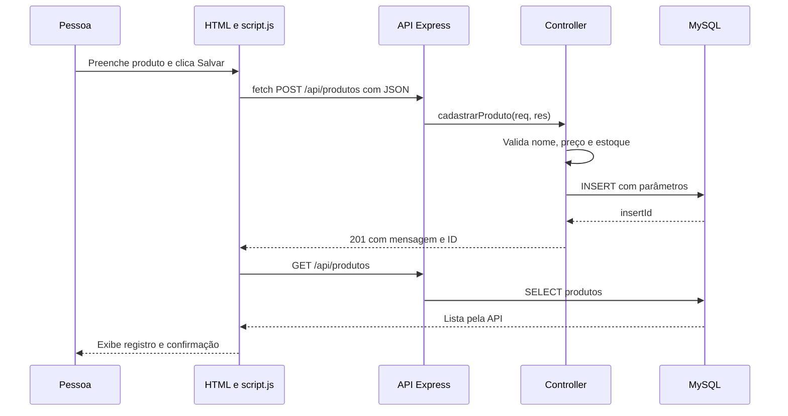

# Roteiro para a avaliação CRUD

Este material ajuda a praticar. A avaliação exige demonstrar e explicar o sistema com suas próprias palavras, conforme o PDF fornecido.

## 1. Apresente o objetivo

Explique que a proposta é aproximar a comunidade de RPG da Taverna Joelho de Grilo. O mural conecta jogadores; a agenda reúne encontros; a loja apresenta itens e registra pedidos demonstrativos. Os dados de exemplo não são anúncios reais da comunidade.

## 2. Mostre a organização

Abra os arquivos e encontre as responsabilidades:

| Parte | Onde abrir | O que explicar |
| --- | --- | --- |
| Interface | `frontend/index.html` | Campos, botões, listas e diálogos |
| Aparência | `frontend/style.css` | Cores, tamanhos, animações e celular |
| Comunicação | `frontend/script.js`, função `requisicao` | `fetch`, método HTTP, JSON e resposta |
| Inicialização | `backend/server.js` | Testa a conexão e escuta a porta 3001 |
| Aplicação | `backend/app.js` | Configura Express, JSON, rotas e frontend |
| Rotas | `backend/routes/produtosRoutes.js` | Liga método e endereço ao controller |
| Regras | `backend/controllers/produtosControllers.js` | Valida dados e executa o SQL |
| Conexão | `backend/database/conexao.js` | Usa o `.env` e cria o pool MySQL |
| Estrutura SQL | `sql/joelho_de_grilo.sql` | Tabelas, chaves e registros de exemplo |

Não exiba a senha do `.env` durante a apresentação; a configuração e o modelo `.env.example` permitem explicar a conexão.

## 3. Faça um CRUD completo ao vivo

Use a loja para ter um exemplo fácil de acompanhar.

1. Inicie o MySQL e rode `npm start` dentro de `backend`. Abra `http://localhost:3001` e crie uma conta. Em outro terminal dentro de `backend`, conceda acesso administrativo com `npm run admin -- email-da-sua-conta@exemplo.com` e atualize a página.
2. Acesse **Loja → Gerenciar catálogo → Novo produto**. Cadastre `Dados da apresentação`, descrição com pelo menos dez caracteres, categoria `Dados`, preço `29,90` e estoque `10`.
3. Mostre o novo registro na gestão e na loja. No Workbench, consulte a tabela para confirmar que ele está persistido.
4. Clique em **Editar**, mude o preço para `34,90` e o estoque para `8`. Salve, atualize a página e confirme os valores no Workbench.
5. Clique em **Excluir**, confirme e mostre que o registro deixou de aparecer tanto na interface quanto no banco.

```sql
USE JOELHO_DE_GRILO;

SELECT id, nome, categoria, preco, estoque
FROM produtos
WHERE nome = 'Dados da apresentação';
```

Recarregar a página ajuda a demonstrar que o dado vem do banco e não apenas de uma lista temporária no navegador. Repita esse exercício com um evento ou uma publicação para ganhar autonomia.

## 4. Explique o caminho dos dados



Para editar, o JavaScript envia `PUT /api/produtos/ID`; para excluir, `DELETE /api/produtos/ID`. O ID é a chave primária do registro. O controller coloca esse valor no parâmetro do `WHERE id = ?`.

No navegador, abra **Ferramentas do desenvolvedor → Rede/Network**, filtre por Fetch/XHR e repita uma ação. Mostre a URL, o método, o corpo JSON, o código de resposta e a lista retornada.

## 5. Mostre a compra e os eventos

Adicione um produto ao inventário, ajuste a quantidade e registre o pedido. Explique que não existe cobrança: a ação cria o pedido e baixa o estoque no banco. Em **Meus pedidos**, mostre o histórico.

```sql
SELECT id, nome, total, status, criado_em FROM pedidos ORDER BY id DESC;
SELECT pedido_id, nome_produto, quantidade, preco_unitario FROM pedido_itens;
SELECT id, nome, estoque FROM produtos;
```

Cadastre um evento futuro, inscreva-se e confira o contador de vagas. Cancele sua inscrição e explique a relação entre `eventos` e `inscricoes`.

```sql
SELECT id, titulo, data_evento, vagas FROM eventos;
SELECT id, evento_id, usuario_id, nome FROM inscricoes;
```

## 6. Pratique respostas curtas

Para mostrar a administração, entre com a conta da equipe e abra **Painel da taverna**. Em **Pessoas & equipe**, cadastre uma pessoa ou use **Tornar admin**, revise a permissão e salve. Demonstre também **Inscrições** na linha de um evento, a alteração da situação de um pedido e a publicação dos textos em **A comunidade**. A nova conta administrativa já pode entrar e usar o painel. O cadastro público continua criando membros.

| Pergunta | Ponto principal |
| --- | --- |
| Onde fica a conexão? | `backend/database/conexao.js`, com valores do `.env`. |
| Qual arquivo inicia o servidor? | `backend/server.js`; `app.js` configura a aplicação. |
| Onde fica o Fetch? | Na função `requisicao` de `frontend/script.js`. |
| Como o sistema sabe qual registro editar? | Pelo ID enviado na URL e usado no `WHERE id = ?`. |
| O que o controller faz? | Valida a entrada, aplica a regra, executa o SQL e responde em JSON. |
| O que acontece com um campo inválido? | O backend retorna `400` e a interface mostra a mensagem. |
| E se o registro já foi removido? | A API retorna `404`. |
| E se acabar o estoque? | A API retorna `409` e o pedido inteiro é desfeito. |
| E se o banco estiver desligado? | Na inicialização, o servidor informa a falha; durante o uso, a API devolve erro e a interface apresenta uma mensagem. |
| Qual é a diferença entre frontend e backend? | O frontend interage com a pessoa; o backend processa os pedidos e acessa o banco. |
| Login era obrigatório no PDF? | Não. Foi incluído para atender à proposta da página de entrada e associar publicações, inscrições e pedidos à conta. |
| Quem pode alterar produtos e eventos? | A equipe com papel `admin`. O middleware `exigirAdmin` verifica a permissão no servidor; o cadastro público cria apenas membros. |
| Como altero o perfil? | O formulário envia `PUT /api/auth/perfil`. O controller valida os campos e atualiza o usuário e seus nomes no mural e nas inscrições. |

## Correspondência com os critérios

| Critério | Evidência no projeto |
| --- | --- |
| Frontend funcional | Telas, formulários, busca, listas e confirmações |
| Backend e API | Express, rotas e controllers por recurso |
| Armazenamento | Banco MySQL e script SQL |
| CREATE / READ / UPDATE / DELETE | Gestão de produtos e eventos; mural |
| Respostas ao usuário | Mensagens de validação, erro, sucesso e carregamento |
| Estrutura e fluxo | Arquivos indicados acima e requisições na aba Network |
| Compreensão e autonomia | Repetir as operações, localizar arquivos e explicar as escolhas |
